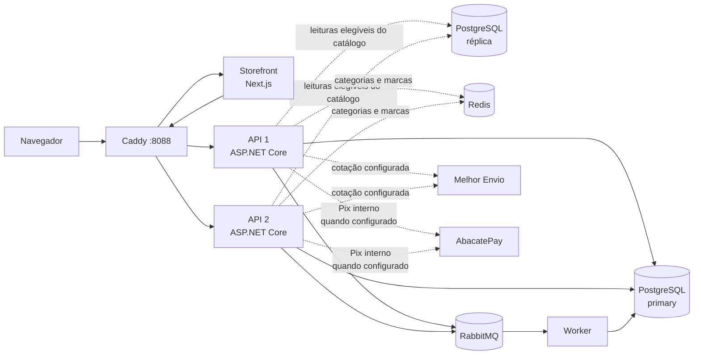
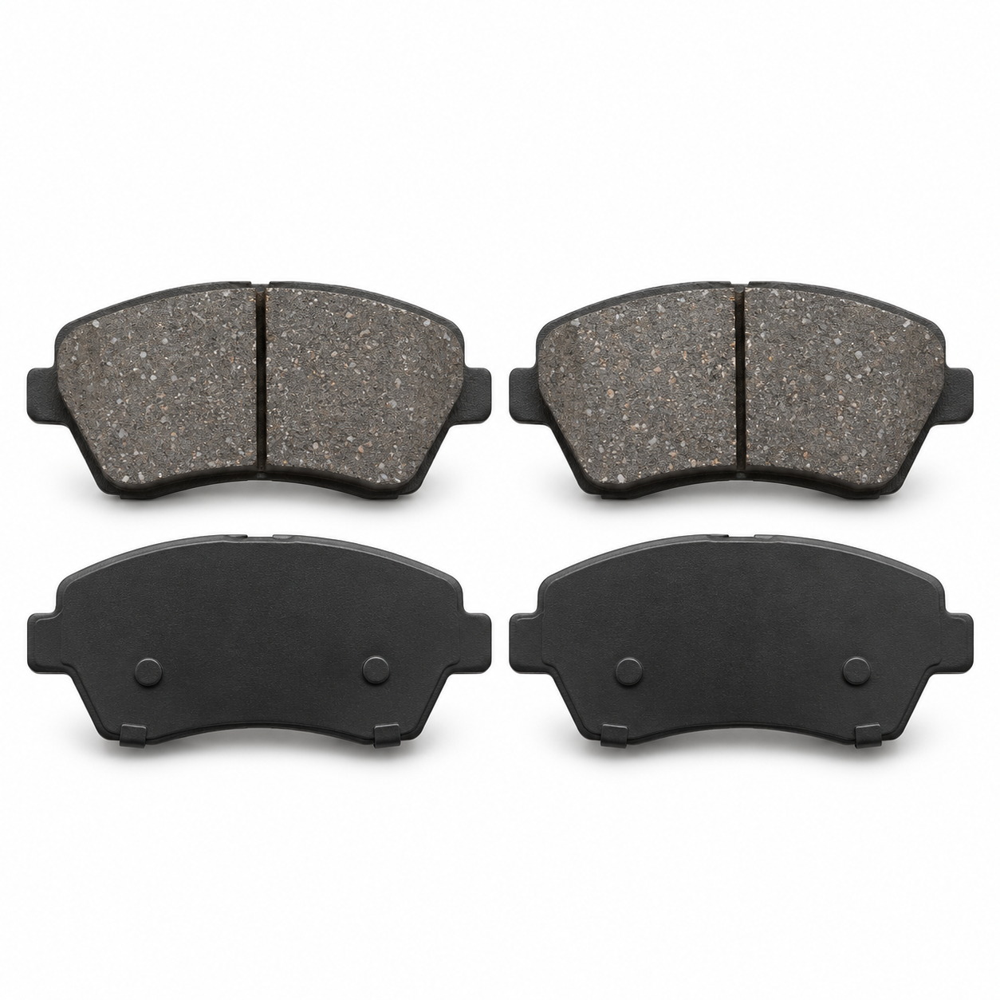
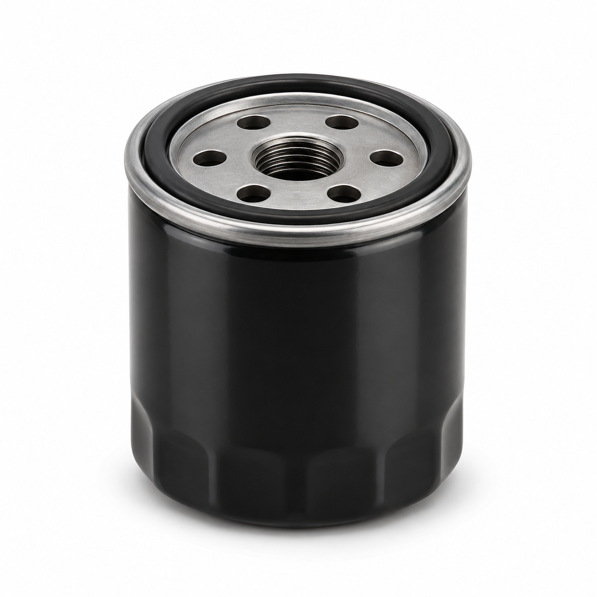
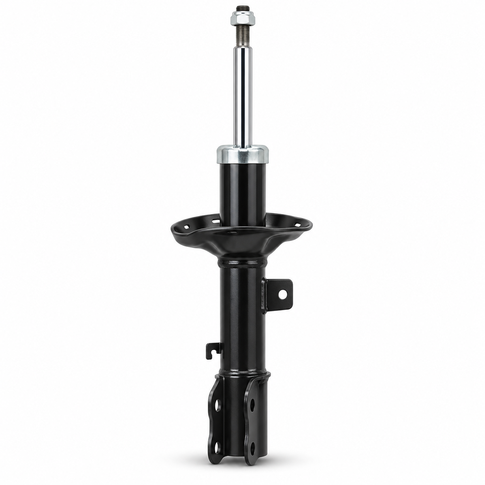
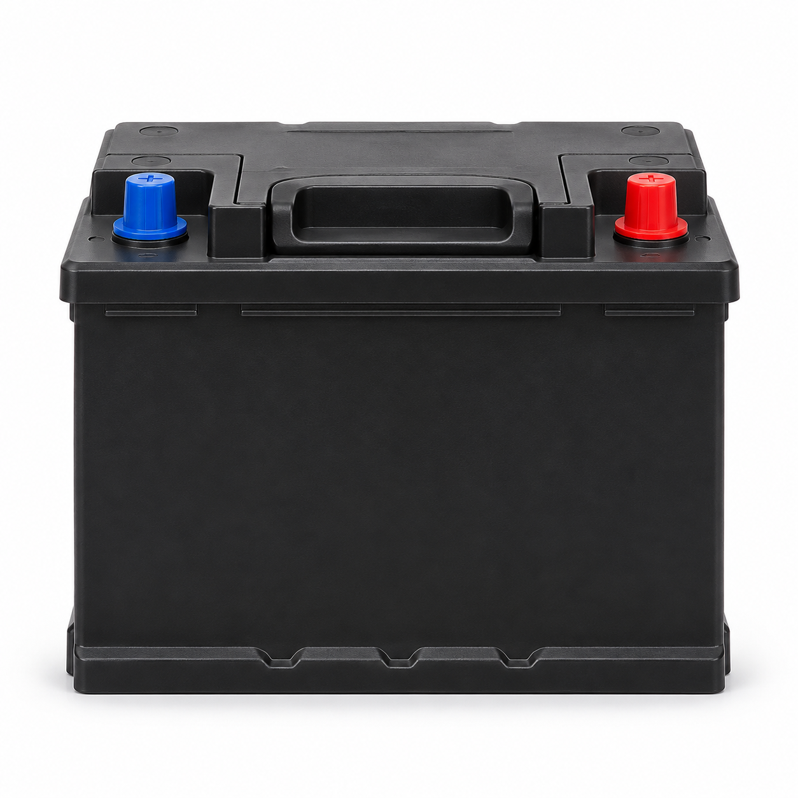
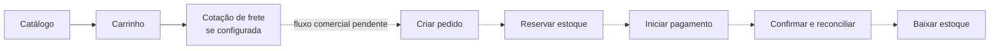

<!-- README: mantenha o estado das funcionalidades alinhado ao código e aos documentos em docs/. -->

<div align="center">
  

  # 57 Brasil Autopeças

  **Plataforma de catálogo automotivo em desenvolvimento**

  Next.js 16 · React 19 · ASP.NET Core / .NET 10 · PostgreSQL · Docker Compose

  [Começar](#início-rápido) · [Arquitetura](#arquitetura) · [Funcionalidades](#funcionalidades) · [Documentação](#documentação)
</div>

<p align="center">
  
</p>

> [!IMPORTANT]
> **Projeto em desenvolvimento. Checkout indisponível.** O repositório ainda não oferece um fluxo comercial completo e testado de pedido, reserva, frete e pagamento. Imagens e valores de demonstração não representam oferta, estoque ou compatibilidade verificada.

## Visão geral

A 57 Brasil reúne busca de peças, catálogo por categoria e marca, seleção progressiva de veículo, carrinho e uma área administrativa inicial. O frontend consulta uma API que mantém as regras de catálogo, estoque e carrinho no servidor. O ambiente local é reproduzível com Docker Compose.

| Área | Estado atual |
| --- | --- |
| Catálogo e busca | Consulta por API, filtros e facetas; vitrine demonstrativa quando não há produtos cadastrados |
| Veículos | Marcas, modelos, versões e aplicações cadastradas |
| Carrinho | Associado à conta autenticada; valores recalculados no servidor |
| Administração | Login de administrador, painel inicial e criação de categorias, marcas e produtos |
| Frete | Cotação via Melhor Envio quando as credenciais estão configuradas |
| Pagamentos | Adaptador Pix AbacatePay selecionável em sandbox; criação e consulta de cobranças testadas com respostas controladas; checkout desabilitado |
| Pedidos | Reserva transacional implementada como serviço interno; criação de pedido para clientes ainda indisponível |
| Endereços | Cadastro autenticado, isolado por cliente e validado no servidor |

**Dados comerciais:** nenhum produto ou compatibilidade é carregado automaticamente no banco. A planilha revisada indicada pelo proprietário ainda precisa ser fornecida e importada com validação. A publicação de produto exige fonte e data de verificação. A migração `CommercialProvenance` retira da vitrine produtos existentes sem essa evidência, preservando seus registros para revisão.

## Início rápido

### Pré-requisitos

- Docker com o plugin Compose e daemon em execução.
- Portas `8088` livres no computador.
- Para executar serviços fora dos containers: Node.js compatível com Next.js 16 e SDK .NET 10.

### Subir o ambiente local

Na raiz do repositório:

```powershell
Copy-Item .env.example .env
```

Edite `.env` e defina uma senha forte em `POSTGRES_PASSWORD`. Depois:

```powershell
docker compose up --build
```

| Endereço | Uso |
| --- | --- |
| [http://localhost:8088](http://localhost:8088) | Storefront |
| [http://localhost:8088/health/live](http://localhost:8088/health/live) | Processo da API em execução |
| [http://localhost:8088/health/ready](http://localhost:8088/health/ready) | Prontidão da API e acesso ao banco |

O Compose executa as migrations em um serviço próprio antes de iniciar as duas instâncias da API. Em um banco com dados, faça backup e revise as migrations antes de aplicá-las.

Para parar os containers sem apagar os volumes:

```powershell
docker compose down
```

> [!NOTE]
> O Compose local usa HTTP e é destinado a desenvolvimento. O arquivo [`compose.production.yaml`](compose.production.yaml) é uma base de implantação, não uma autorização para operação comercial. Consulte o [guia de implantação](docs/DEPLOYMENT.md).

## Arquitetura



A API segue um monólito modular: domínio e regras em `Brasil57.Domain`, contratos em `Brasil57.Application`, persistência e integrações em `Brasil57.Infrastructure`, HTTP em `Brasil57.Api`. O worker trata notificações persistidas. A réplica atende apenas consultas elegíveis do catálogo e a leitura volta ao banco principal se ela estiver atrasada ou indisponível. Redis acelera listas de categorias e marcas; falhas de cache não impedem a leitura do banco. O inbox PostgreSQL é a fonte de verdade das notificações, mesmo quando RabbitMQ falha.

### Organização do repositório

```text
57brasil1/
├── apps/storefront/            # Next.js, páginas, componentes e assets
├── backend/
│   ├── src/
│   │   ├── Brasil57.Api/       # Endpoints e composição da aplicação
│   │   ├── Brasil57.Application/ # Contratos
│   │   ├── Brasil57.Domain/    # Entidades e regras
│   │   ├── Brasil57.Infrastructure/ # EF Core e provedores
│   │   └── Brasil57.Worker/    # Processamento assíncrono
│   └── tests/                  # Testes unitários e de integração
├── docs/                       # Referência técnica e operacional
├── infrastructure/             # Caddy e scripts PostgreSQL
├── compose.yaml                # Ambiente local
└── compose.production.yaml     # Base de implantação
```

## Funcionalidades

### Descoberta de peças

O catálogo oferece busca, filtros por marca/categoria, faixa de preço, disponibilidade e aplicações por versão/ano do veículo. As facetas são calculadas sobre o conjunto filtrado no PostgreSQL. A página inicial mostra peças **demonstrativas** quando não há produtos cadastrados; seus valores não são ofertas.

<p align="center">
  
  
  
  
</p>
<p align="center"><sub>Imagens ilustrativas do catálogo de demonstração.</sub></p>

### Carrinho e administração

O carrinho exige uma conta autenticada e usa o cookie de sessão HttpOnly. A API confere preços e disponibilidade no banco e exige mesma origem nas escritas. Adicionar um item **não reserva estoque**. A administração exige autenticação e papel `Administrator` no servidor; o cadastro inicial de categoria, marca e produto possui auditoria.

### Frete e pagamento

A cotação usa Melhor Envio quando `SHIPPING_TOKEN`, `SHIPPING_ORIGIN_CEP` e `SHIPPING_USER_AGENT` estão definidos. Sem configuração, a API responde indisponibilidade em vez de inventar frete. O adaptador Pix AbacatePay usa `PAYMENT_GATEWAY=abacatepay`, `PAYMENT_ENVIRONMENT=sandbox` e `ABACATEPAY_API_KEY` no processo da API, mas ainda não é exposto ao cliente. Não há webhook AbacatePay, conciliação automática ou testes com credenciais sandbox. O webhook do Mercado Pago é independente e continua desabilitado por padrão. Configurar qualquer adaptador **não habilita checkout**.



A reserva e a confirmação transacional já têm implementação interna e testes de integração. Faltam os endpoints e a validação ponta a ponta necessários para oferecer o fluxo ao cliente.

## Configuração

Copie [`.env.example`](.env.example) para `.env` e mantenha o arquivo local fora do Git. Os grupos principais são:

| Variáveis | Finalidade |
| --- | --- |
| `POSTGRES_PASSWORD` | Obrigatória no Compose local; usada pelos serviços locais de dados |
| `BOOTSTRAP_ADMIN_EMAIL`, `BOOTSTRAP_ADMIN_PASSWORD` | Criação inicial do administrador |
| `SHIPPING_*` | Credenciais e origem para cotação Melhor Envio |
| `MERCADO_PAGO_*`, `PUBLIC_SITE_URL` | Configuração do provedor de pagamento e webhook |
| `POSTGRES_REPLICATION_PASSWORD`, `REDIS_PASSWORD`, `RABBITMQ_PASSWORD` | Segredos próprios exigidos no template de produção |

O ambiente local atual usa `POSTGRES_PASSWORD` também nos serviços Redis, RabbitMQ e réplica; o template de produção exige senhas distintas. Consulte [integrações](docs/INTEGRATIONS.md) e [implantação](docs/DEPLOYMENT.md) antes de alterar essas configurações.

## Desenvolvimento e testes

```powershell
npm ci --prefix apps/storefront
npm run typecheck --prefix apps/storefront
npm run build --prefix apps/storefront

dotnet build backend/src/Brasil57.Api/Brasil57.Api.csproj
dotnet test backend/tests/Brasil57.UnitTests/Brasil57.UnitTests.csproj
dotnet test backend/tests/Brasil57.IntegrationTests/Brasil57.IntegrationTests.csproj

docker compose config --quiet
```

Os testes de integração executam migrations e deixam dados no PostgreSQL informado em `BRASIL57_TEST_DATABASE`: use **somente um banco descartável**. Os testes opcionais de infraestrutura usam `BRASIL57_TEST_REDIS_PASSWORD` e `BRASIL57_TEST_RABBIT_PASSWORD` quando definidos. Consulte [banco de dados](docs/DATABASE.md) para detalhes.

Para desenvolver somente a interface, rode `npm run dev --prefix apps/storefront`. Páginas que consultam o catálogo precisam de uma API acessível; `API_INTERNAL_URL` define o endereço usado pelo frontend no servidor.

## Antes de operar comercialmente

- Integrar e testar criação de pedido, reserva, frete, início de pagamento, confirmação e reconciliação.
- Validar origem de preços, estoque, ofertas e aplicações técnicas antes da publicação.
- Concluir administração de estoque, imagens, importação e operação de pedidos.
- Executar testes completos em sandbox, acessibilidade, segurança, carga e jornada ponta a ponta.
- Revisar políticas legais, LGPD, backups externos, restauração e operação de produção.

## Documentação técnica

| Documento | Conteúdo |
| --- | --- |
| [Arquitetura](docs/ARCHITECTURE.md) | Componentes e estado das fases |
| [API](docs/API.md) | Rotas, filtros e regras de acesso |
| [Banco de dados](docs/DATABASE.md) | Modelo, migrations e testes de integração |
| [Integrações](docs/INTEGRATIONS.md) | Melhor Envio e Mercado Pago |
| [Segurança](docs/SECURITY.md) | Controles e pendências |
| [Implantação](docs/DEPLOYMENT.md) | Compose, migrations e operação |
| [Decisões técnicas](docs/DECISIONS.md) | Registro de decisões |
| [Serviços distribuídos](docs/architecture/distributed-services.md) | Réplica, cache e fila |
